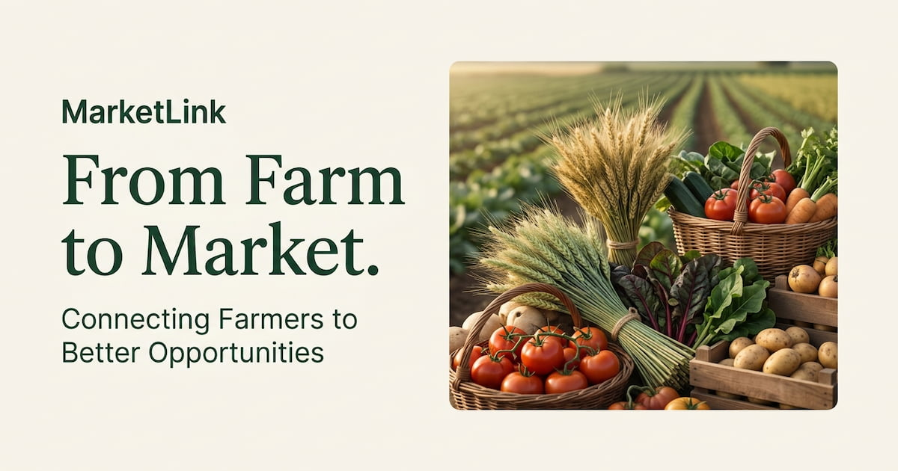

# MarketLink: Farmers Market Platform



**MarketLink** is a web app that connects local farmers with customers. Find farmers markets near you, browse fresh produce, pre-order and pick up in person.

**Live app:** https://marketlink-eta.vercel.app/
**Built by:** [Hamza Aamir](https://hamzaamir-portfolio.web.app/), software engineer
**More projects:** https://hamzaamir-portfolio.web.app/

## Features

- Browse local farmers markets on a map
- Search and filter fresh products
- Cart, pre-orders and order history
- Favorites, reviews and notifications
- AI chat assistant
- Farmer dashboard: stall profile, products and incoming orders
- Admin dashboard: markets, categories, farmers, customers, orders, reviews, announcements and reports

## Tech Stack

React, Vite, Tailwind CSS, React Router, Zustand, TanStack Query, Axios

## Getting Started

```bash
git clone https://github.com/x-hamza47/marketlink.git
cd marketlink
npm install
npm run dev
```

Create a `.env` file in the project root with your API URL (see `.env.example` if you add one).

## Scripts

| Command | What it does |
| --- | --- |
| `npm run dev` | Start the dev server |
| `npm run build` | Build for production |
| `npm run preview` | Preview the production build |

## Author

**Hamza Aamir**, software engineer building web, desktop and mobile apps.

- Portfolio: https://hamzaamir-portfolio.web.app/
- GitHub: https://github.com/x-hamza47
- LinkedIn: https://www.linkedin.com/in/hamza-aamir-dev/
